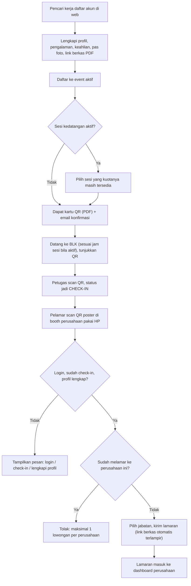
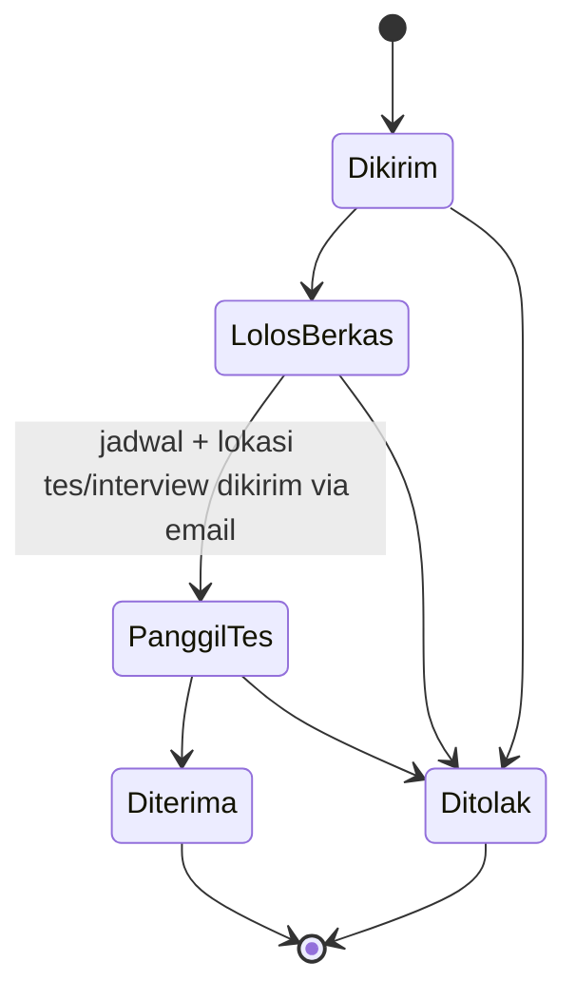
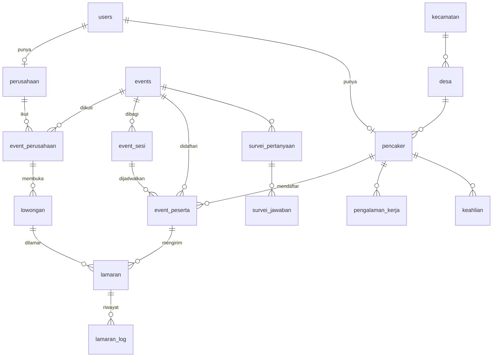

# Perancangan Aplikasi Job Market Fair – BLK Pasuruan

Dokumen ini disusun dari hasil wawancara kebutuhan. Silakan periksa, beri koreksi, lalu tekan **Proceed** jika sudah sesuai supaya kita lanjut ke tahap pembuatan.

## 1. Ringkasan Kebutuhan

| Aspek | Keputusan |
|---|---|
| Format acara | Offline di BLK Pasuruan, **1 event per tahun** |
| Skala | 20–50 perusahaan, 1.000–5.000 pencari kerja |
| Teknologi | **CodeIgniter 4.6** (PHP 8.2) + MySQL + Bootstrap 5 |
| Deployment | Hosting online + domain (**wajib HTTPS**) |
| Biaya perusahaan | Gratis (tidak ada modul pembayaran) |
| File yang diunggah pelamar | **Hanya pas foto** (JPG/PNG, maks. 1 MB) |
| Berkas lamaran | CV, ijazah, sertifikat, dll. **digabung jadi 1 PDF** oleh pelamar, lalu diisikan sebagai **1 link (Google Drive)** |
| Jadwal kedatangan | **Sesi kedatangan opsional** (bisa diaktifkan/nonaktifkan admin), kuota per sesi diatur admin |
| Cara melamar | Pelamar **scan QR booth** dengan HP sendiri, lalu pilih jabatan |
| Batas lamaran | **1 lowongan per perusahaan** per pelamar |
| Syarat melamar | Sudah **check-in** di meja registrasi + profil lengkap (termasuk foto & link berkas) |
| Waktu melamar | Hanya saat hari-H |
| Interview | Tidak ada saat acara. Perusahaan menyeleksi setelah acara (batas waktu diatur admin) |
| Notifikasi | Email + status di dashboard pelamar |
| Data antar-tahun | Akun pelamar tetap tersimpan, data lamaran dipisah per event |

## 2. Peran Pengguna (Role)

| Role | Cara mendapat akun | Hak akses utama |
|---|---|---|
| **Admin BLK** | Dibuat saat instalasi | Kelola event, sesi kedatangan, perusahaan (termasuk membuatkan akun), lowongan, booth, petugas, pimpinan, survei, laporan, pengaturan |
| **Perusahaan** | Dibuatkan admin (1 akun per perusahaan) | Lengkapi profil, kelola lowongan, lihat & saring pelamar, buka link berkas, ubah status, kirim jadwal tes/interview, lapor penempatan |
| **Pencari Kerja** | Daftar sendiri lewat web (online sebelum hari-H, atau di lokasi bagi walk-in) | Kelola profil, foto & link berkas, pilih sesi kedatangan, unduh kartu QR, melamar di booth, pantau status, isi survei |
| **Petugas Registrasi** | Dibuatkan admin | Scan QR kartu peserta untuk check-in (dengan info kesesuaian sesi), cari peserta berdasarkan NIK/nama |
| **Pimpinan / Disnaker** | Dibuatkan admin | Hanya melihat dashboard & laporan, unduh Excel/PDF |

## 3. Alur Utama

### 3.1 Alur Pendaftaran & Hari-H (pencari kerja)



Peserta walk-in yang belum punya akun mendaftar sendiri di lokasi lewat HP (bisa dibantu poster QR ke halaman pendaftaran), lalu check-in di meja registrasi. Jika sesi aktif, walk-in memilih sesi yang masih tersedia.

### 3.2 Sesi Kedatangan (opsional)

Tujuannya agar pelamar tidak menumpuk di lokasi ketika pendaftar banyak.

**Pengaturan oleh admin (per event):**
- Saklar **Aktifkan sesi kedatangan** (ya/tidak).
- Daftar sesi: nama sesi, tanggal, jam mulai–selesai, **kuota pendaftar per sesi**. Contoh:

| Sesi | Jam | Kuota |
|---|---|---|
| Sesi 1 | 08.00–10.00 | 1.000 |
| Sesi 2 | 10.00–12.00 | 1.000 |
| Sesi 3 | 13.00–15.00 | 1.000 |

- Aturan check-in di luar jam sesi: **peringatan saja** (petugas tetap bisa meloloskan) atau **tolak**.
- Kelola peserta per sesi: lihat daftar, pindahkan peserta ke sesi lain.

**Perilaku sistem:**
- Saat mendaftar event, pelamar wajib memilih sesi. Sesi yang penuh tampil abu-abu dan tidak bisa dipilih. Sisa kuota ditampilkan.
- Jika semua sesi penuh, pendaftaran event otomatis ditutup dengan pesan "Kuota pendaftaran penuh".
- Pelamar boleh **pindah sesi** selama kuota sesi tujuan masih ada dan pendaftaran belum ditutup.
- Kuota dijaga dengan transaksi database + penguncian baris, sehingga tidak bisa terlampaui walau banyak orang mendaftar bersamaan.
- Kartu QR dan email konfirmasi mencantumkan **nama sesi, tanggal, dan jam kedatangan**.
- Saat petugas scan QR, layar menampilkan status: **Sesuai sesi** (hijau), **Belum waktunya** atau **Lewat sesi** (kuning/merah), lalu mengikuti aturan check-in di atas.
- **Jika diaktifkan setelah ada pendaftar:** pendaftar yang belum punya sesi diminta memilih saat login berikutnya, atau admin memakai tombol **Bagi otomatis** untuk menyebar mereka ke sesi yang masih kosong.
- **Jika dinonaktifkan:** data sesi tetap tersimpan tapi diabaikan; semua peserta bebas datang selama jam acara.

### 3.3 Alur Seleksi Setelah Acara



- Setiap perubahan status dicatat di riwayat dan memicu **email** ke pelamar.
- Setelah **batas waktu seleksi** (diatur admin per event, mis. 30 hari), perusahaan tidak bisa mengubah status lagi.
- Status **Diterima** = data penempatan kerja, dipakai di laporan.

## 4. Daftar Fitur per Modul

### A. Halaman Publik
- Beranda: info event aktif (tanggal, jam, lokasi, hitung mundur, sisa kuota per sesi jika sesi aktif)
- Daftar perusahaan peserta dan lowongan (filter pendidikan, jabatan, ramah disabilitas)
- Detail lowongan
- Daftar akun dan login

### B. Admin BLK
- **Event**: buat event tahunan, atur tanggal, status (draf/aktif/selesai), batas waktu seleksi, buka/tutup pendaftaran & lamaran
- **Sesi kedatangan**: aktif/nonaktif, kelola sesi & kuota, aturan check-in di luar sesi, daftar & pindah peserta per sesi, bagi otomatis
- **Perusahaan**: input data perusahaan + buat akun login (reset password)
- **Peserta event**: tambahkan perusahaan ke event, isi nomor booth, **cetak poster QR booth (PDF)**
- **Lowongan**: lihat/ubah/nonaktifkan lowongan semua perusahaan
- **Pencari kerja**: lihat data, cari NIK, nonaktifkan akun
- **Pengguna**: akun petugas registrasi & pimpinan
- **Survei**: susun pertanyaan untuk peserta dan perusahaan
- **Pengaturan**: identitas BLK, kop surat, logo, SMTP email
- **Laporan** (lihat bagian F)

### C. Perusahaan
- Profil perusahaan (logo, alamat, bidang usaha, kontak HRD)
- Lowongan: posisi, deskripsi, kualifikasi, pendidikan minimal, jenis kelamin, batas usia, **kuota**, rentang gaji, lokasi kerja, terbuka untuk disabilitas
- Daftar pelamar per lowongan + filter (pendidikan, gender, usia, kecamatan, status)
- Lihat profil pelamar & **buka link berkas** (1 PDF gabungan CV, ijazah, sertifikat, dll.)
- Ubah status (satuan & massal) + isi jadwal/lokasi tes
- Rekap penempatan (kuota vs diterima)
- Export daftar pelamar ke Excel (termasuk kolom link berkas)
- Isi survei kepuasan

### D. Pencari Kerja
- Profil: NIK (16 digit, unik), nama, tempat/tgl lahir, jenis kelamin, alamat (pilih **domisili Kab. Pasuruan** → dropdown kecamatan/desa, atau **luar Kab. Pasuruan** → isian kabupaten/kota bebas), HP/WA, email, pendidikan & jurusan, status & jenis disabilitas
- **Pas foto**: unggah JPG/PNG, **maks. 1 MB**
- **Link berkas lamaran — wajib, 1 input saja**: pelamar menggabungkan CV, ijazah terakhir, sertifikat pelatihan, dan berkas lain ke dalam **1 file PDF**, mengunggahnya sendiri ke Google Drive, lalu menempelkan link-nya. Form menampilkan petunjuk singkat cara menggabungkan PDF dan mengatur akses berbagi.
- Pengalaman kerja (banyak entri)
- Keahlian/sertifikat pelatihan (banyak entri, tanda alumni BLK; data teks saja, file sertifikat ada di PDF gabungan)
- Daftar event + **pilih sesi kedatangan** (bila aktif), pindah sesi
- **Unduh kartu peserta ber-QR (PDF)**, mencantumkan sesi & jam kedatangan
- Halaman melamar (dari scan QR booth)
- Riwayat lamaran & status, termasuk jadwal tes
- Isi survei kepuasan

### E. Petugas Registrasi
- Pemindai QR lewat kamera HP/laptop (browser)
- Hasil scan: foto, nama, NIK, sesi terdaftar + indikator kesesuaian jam sesi
- Pencarian manual NIK/nama (jika QR rusak/HP mati), lalu check-in
- Statistik singkat: total hadir hari ini, hadir per sesi

### F. Dashboard & Laporan (Admin & Pimpinan)
- **Dashboard real-time hari-H**: pendaftar vs hadir, **terdaftar vs hadir per sesi**, lamaran masuk, grafik per jam, perusahaan terbanyak dilamar (auto-refresh)
- Statistik pelamar per perusahaan / per jabatan
- Demografi: gender, kelompok usia, pendidikan, kecamatan, disabilitas
- Penempatan: lowongan vs kuota vs diterima (tingkat penempatan %)
- Hasil survei
- **Export Excel** dan **cetak PDF berkop BLK**

## 5. Rancangan Basis Data



| Tabel | Kolom penting |
|---|---|
| `users` | id, nama, email (unik), password (hash), role (`admin`/`petugas`/`pimpinan`/`perusahaan`/`pencaker`), is_active, last_login |
| `events` | id, nama, tahun, tanggal, jam_mulai, jam_selesai, lokasi, deskripsi, banner, pendaftaran_dibuka (bool), lamaran_dibuka (bool), batas_seleksi (date), **sesi_aktif** (bool), **aturan_luar_sesi** (`peringatan`/`tolak`), status |
| `event_sesi` | id, event_id, nama, tanggal, jam_mulai, jam_selesai, **kuota**, urutan |
| `perusahaan` | id, user_id, nama, bidang_usaha, alamat, kota, telp, email, website, logo, deskripsi, nama_hrd, hp_hrd |
| `event_perusahaan` | id, event_id, perusahaan_id, no_booth, **qr_token** (acak, unik) |
| `lowongan` | id, event_perusahaan_id, jabatan, deskripsi, kualifikasi, pendidikan_min, jenis_kelamin, usia_max, kuota, gaji_min, gaji_max, lokasi_kerja, ramah_disabilitas, is_active |
| `pencaker` | id, user_id, **nik (unik)**, nama, tempat_lahir, tgl_lahir, jk, alamat, domisili (`kab_pasuruan`/`luar`), desa_id (null jika luar), kota_luar, hp, pendidikan, jurusan, disabilitas, jenis_disabilitas, foto, **link_berkas** (wajib), profil_lengkap |
| `pengalaman_kerja` | id, pencaker_id, nama_perusahaan, jabatan, tahun_mulai, tahun_selesai |
| `keahlian` | id, pencaker_id, nama, penerbit, tahun, alumni_blk |
| `kecamatan`, `desa` | referensi wilayah Kab. Pasuruan |
| `event_peserta` | id, event_id, pencaker_id, **sesi_id** (null jika sesi nonaktif), no_registrasi, **qr_token**, created_at, checkin_at, checkin_by, checkin_luar_sesi (bool) — unik (event_id, pencaker_id) |
| `lamaran` | id, event_peserta_id, lowongan_id, event_perusahaan_id, status, jadwal_tes, lokasi_tes, catatan, created_at, updated_at — **unik (event_peserta_id, event_perusahaan_id)** untuk aturan 1 lowongan per perusahaan |
| `lamaran_log` | id, lamaran_id, status_lama, status_baru, catatan, user_id, created_at |
| `survei_pertanyaan` | id, event_id, target (`pencaker`/`perusahaan`), pertanyaan, tipe (skala 1–5 / teks), urutan |
| `survei_jawaban` | id, pertanyaan_id, user_id, nilai, jawaban_teks |
| `email_queue` | id, tujuan, subjek, isi, status, percobaan, created_at (email dikirim bertahap lewat cron) |
| `pengaturan` | key, value (nama instansi, alamat, logo, kop, SMTP) |

## 6. Arsitektur & Struktur Folder

**Framework: CodeIgniter 4.6** (PHP 8.2, pola MVC), dipasang lewat Composer. Hanya folder `public/` yang terbuka ke internet. Kode aplikasi, konfigurasi, dan file upload berada di luar folder publik.

```
jmf/
├── app/
│   ├── Config/            # Routes.php, Filters.php, Email.php, Database.php
│   ├── Controllers/
│   │   ├── Home.php, Auth.php, Lowongan.php     # publik & login/daftar
│   │   ├── Admin/         # Dashboard, Event, Sesi, Perusahaan, Booth, Lowongan,
│   │   │                  # Pencaker, Pengguna, Survei, Pengaturan, Laporan
│   │   ├── Perusahaan/    # Profil, Lowongan, Pelamar
│   │   ├── Pencaker/      # Profil, Pengalaman, Keahlian, Event, Lamar, Status
│   │   ├── Petugas/       # Checkin (scanner)
│   │   └── Pimpinan/      # Dashboard, Laporan (read-only)
│   ├── Filters/           # AuthFilter, RoleFilter (cek login & role per grup route)
│   ├── Models/            # satu model per tabel (validasi & allowedFields)
│   ├── Libraries/         # QrService, PdfService, ExcelService, MailQueue, SesiService
│   ├── Commands/          # `php spark email:kirim` (dijalankan cron)
│   ├── Database/
│   │   ├── Migrations/    # struktur tabel
│   │   └── Seeds/         # admin awal, wilayah Kab. Pasuruan, survei bawaan
│   └── Views/             # layouts/, publik/, admin/, perusahaan/, pencaker/, petugas/, pimpinan/
├── public/                # index.php, .htaccess, assets/ (css, js, img)  ← document root
├── writable/
│   └── uploads/           # foto/, logo/ (tidak bisa diakses langsung)
├── vendor/                # CodeIgniter & library Composer
└── .env                   # kredensial DB & SMTP (tidak ikut diunggah ke publik)
```

**Pembagian route per role** (diamankan filter):

| Grup URL | Filter |
|---|---|
| `/`, `/lowongan`, `/login`, `/daftar` | publik |
| `/admin/*` | `auth` + `role:admin` |
| `/perusahaan/*` | `auth` + `role:perusahaan` |
| `/pencaker/*` | `auth` + `role:pencaker` |
| `/petugas/*` | `auth` + `role:petugas,admin` |
| `/pimpinan/*` | `auth` + `role:pimpinan,admin` |
| `/lamar/{token}` | `auth` + `role:pencaker` (target QR booth) |

**Library pendukung**

| Kebutuhan | Library |
|---|---|
| Framework | CodeIgniter 4.6 (validasi, CSRF, session, query builder, image, email bawaan) |
| Tampilan | Bootstrap 5, DataTables |
| Grafik | Chart.js |
| Scan QR (kamera) | html5-qrcode (JS) |
| Membuat QR | chillerlan/php-qrcode |
| PDF (kartu, poster, laporan) | Dompdf |
| Excel | PhpSpreadsheet |
| Email | Library Email bawaan CI4 (SMTP hosting, pengirim `jmf@uptblkpasuruan.com`) |

## 7. Keamanan & Hal Teknis

Fitur keamanan bawaan CodeIgniter 4 yang diaktifkan:

| Ancaman | Perlindungan |
|---|---|
| SQL injection | Query Builder & Model (parameter otomatis di-escape) |
| XSS | `esc()` di semua view + header Content Security Policy |
| CSRF | Filter `csrf` global untuk semua POST (token di setiap form) |
| Akses tidak sah | Filter `auth` + `role` per grup route, ditambah cek kepemilikan data (perusahaan hanya bisa melihat pelamarnya sendiri) |
| Session hijacking | Session di database, regenerasi ID setelah login, cookie `HttpOnly` + `Secure` + `SameSite` |
| Brute-force login | Filter `throttle` (batas percobaan login per IP) |
| Header keamanan | Filter `secureheaders` (X-Frame-Options, X-Content-Type-Options, dll.) |
| Bocor konfigurasi | Kredensial di `.env`, `CI_ENVIRONMENT=production` (error tidak ditampilkan) |

Hal teknis lain:
- Password dengan `password_hash()` (bcrypt/argon2).
- **HTTPS wajib** (`forceGlobalSecureRequests = true`), karena browser hanya mengizinkan akses kamera (scanner) di HTTPS.
- **Document root hosting diarahkan ke `public/`**. Jika hosting tidak mengizinkan, folder `app/`, `writable/`, `vendor/` diletakkan di luar `public_html`.
- QR booth berisi URL + token acak (`/lamar/TOKEN`), bukan ID berurutan, sehingga tidak bisa ditebak.
- **Pas foto**: validasi `uploaded`, `is_image`, `mime_in[jpg,png]`, `max_size[1024]`; nama file acak; otomatis diperkecil (mis. 400×600 px) agar hemat ruang (±50–100 KB per foto, total ±500 MB untuk 5.000 pelamar); hanya bisa ditampilkan lewat controller yang mengecek hak akses.
- **Link berkas** (1 PDF gabungan): wajib diawali `https://` (link `javascript:` dan sejenisnya ditolak), disarankan Google Drive. Di form ditampilkan petunjuk agar akses berbagi diatur **"Siapa saja yang memiliki link"**. Link dibuka di tab baru dengan `rel="noopener noreferrer"`.
- **Kuota sesi**: pendaftaran & pindah sesi dijalankan dalam transaksi dengan `SELECT ... FOR UPDATE` agar kuota tidak terlampaui.
- Persetujuan pemrosesan data pribadi saat mendaftar (UU PDP No. 27/2022).
- Pemakaian puncak saat hari-H ±5.000 pengguna: index pada kolom NIK, qr_token, sesi_id, dan foreign key; email lewat antrean agar halaman tidak lambat.

## 8. Tahapan Pengerjaan

| Tahap | Isi |
|---|---|
| 1. Fondasi | Instal CodeIgniter 4 via Composer, `.env`, migration & seeder, login multi-role + filter, layout per role |
| 2. Master data | Event, **sesi kedatangan**, perusahaan + akun, booth, wilayah, pengguna internal |
| 3. Pencari kerja | Pendaftaran, profil, pas foto, link berkas, daftar event + pilih sesi, kartu QR |
| 4. Perusahaan | Profil, lowongan, halaman publik lowongan |
| 5. Hari-H | Scanner check-in (dengan cek sesi), poster QR booth, alur melamar |
| 6. Seleksi | Status lamaran, jadwal tes, email |
| 7. Laporan | Dashboard real-time (termasuk per sesi), laporan, Excel, PDF berkop |
| 8. Survei & finalisasi | Survei, uji coba beban, panduan pengguna |

## 9. Keputusan Tambahan

| Hal | Keputusan |
|---|---|
| Wilayah peserta | Peserta **luar Kab. Pasuruan boleh** mendaftar. Laporan demografi dikelompokkan per kecamatan (Kab. Pasuruan) + "Luar Kab. Pasuruan" per kab/kota |
| Email pengirim | `jmf@uptblkpasuruan.com`. Host, port, dan password SMTP diisi admin di menu Pengaturan |
| Jenjang pendidikan | Pilihan tetap: SD, SMP, SMA, SMK, D1, D2, D3, D4/S1, S2. Jurusan diisi bebas |
| Kartu AK/1 | Tidak digunakan |
| Unggahan file | Hanya pas foto (JPG/PNG, maks. 1 MB). CV, ijazah, sertifikat, dan berkas lain **digabung dalam 1 PDF** dan diisikan sebagai **1 link** |
| Sesi kedatangan | Opsional per event, kuota per sesi diatur admin |
| Survei | Belum ada format baku. Disediakan **pertanyaan bawaan** (di bawah) yang bisa diubah/ditambah admin |

### Pertanyaan survei bawaan (skala 1–5 + saran)

**Pencari kerja**
1. Kemudahan proses pendaftaran online
2. Kecepatan & keramahan layanan check-in
3. Kemudahan melamar lewat scan QR booth
4. Kesesuaian lowongan dengan pendidikan/keahlian Anda
5. Kenyamanan lokasi & penataan acara
6. Kepuasan keseluruhan terhadap Job Market Fair
7. Saran dan masukan (teks)

**Perusahaan**
1. Kemudahan penggunaan aplikasi (kelola lowongan & pelamar)
2. Kualitas/kesesuaian pelamar dengan kebutuhan perusahaan
3. Pelayanan panitia BLK
4. Fasilitas booth & lokasi acara
5. Minat ikut kembali tahun depan
6. Kepuasan keseluruhan
7. Saran dan masukan (teks)
